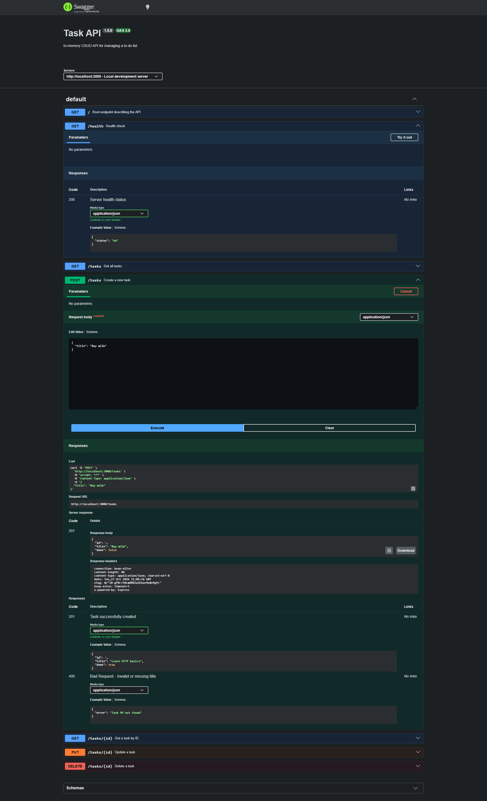
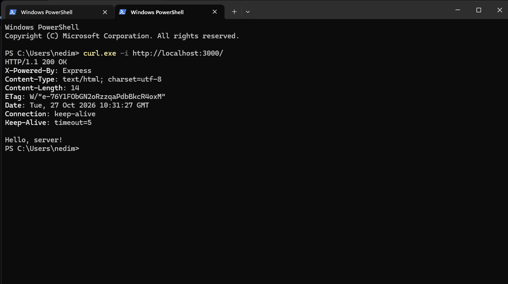
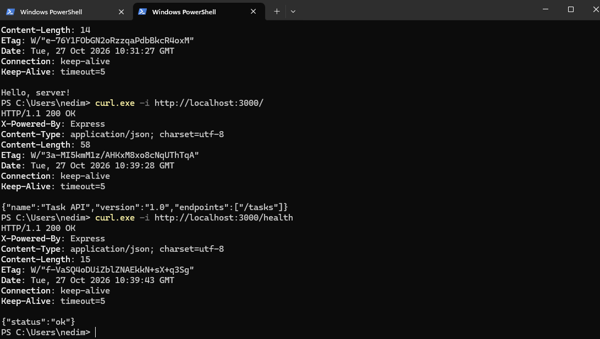
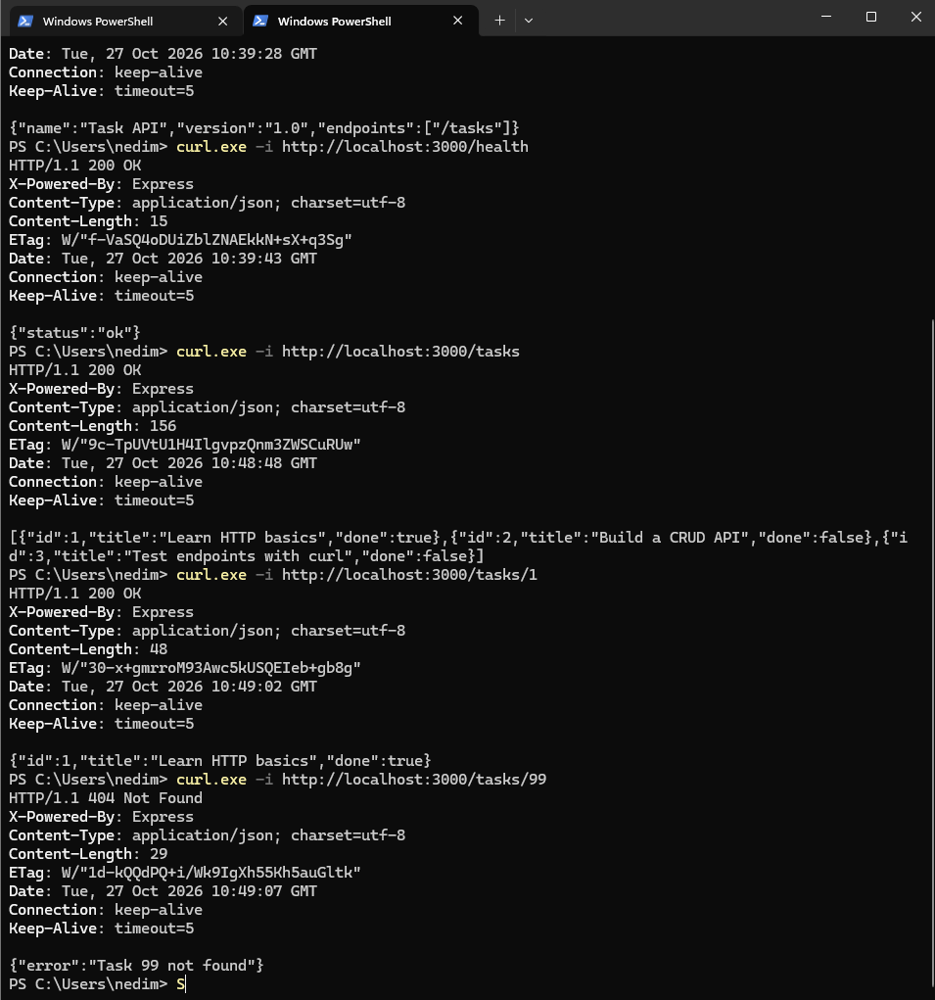
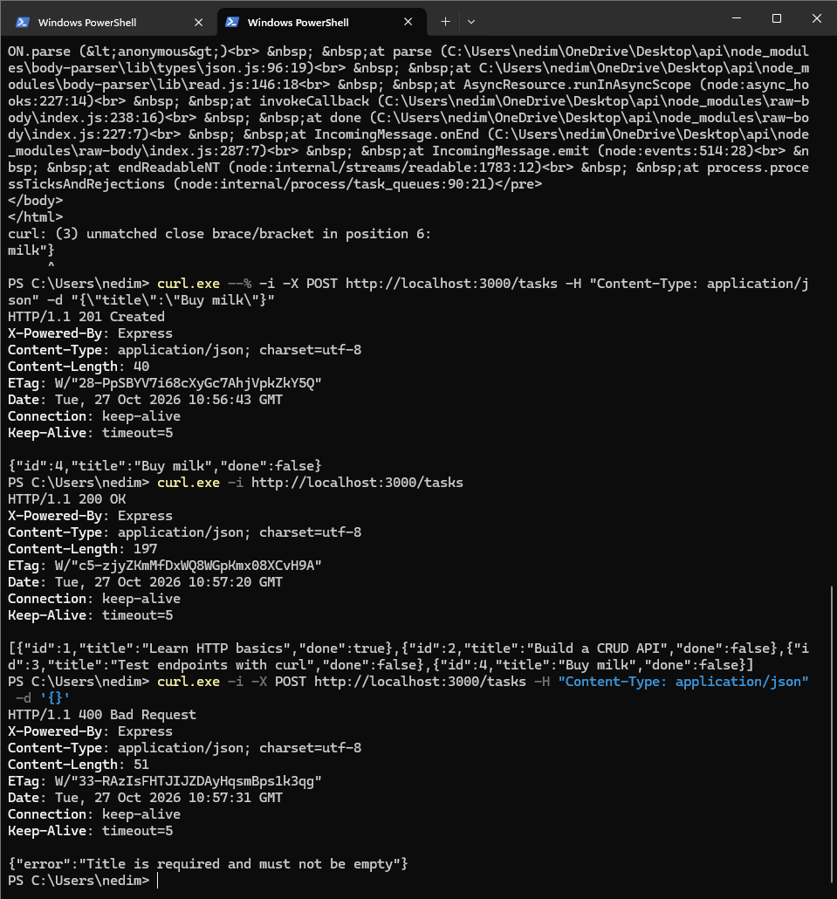
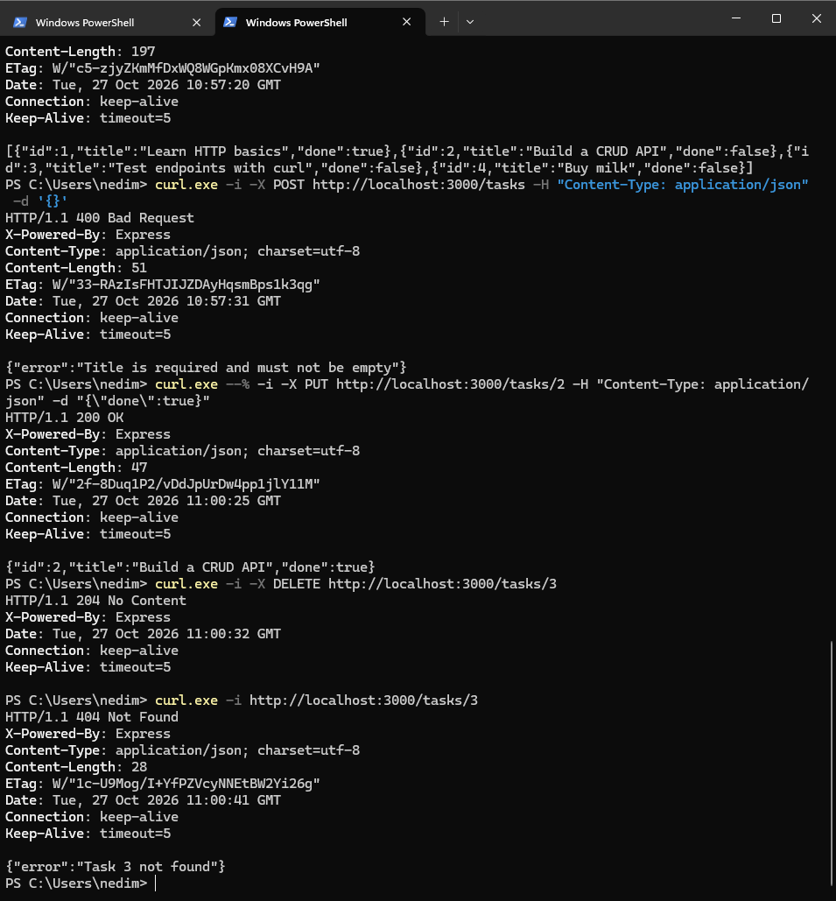

# Task API — FlyRank W2 · A1

A lightweight RESTful CRUD API built with Node.js and Express that manages an in-memory to-do list. The API provides endpoints to create, read, update, and delete tasks, features strict input validation, and includes interactive Swagger UI documentation at `/docs`.

---

## Features

- **Full CRUD operations**: Create, Read (all & by ID), Update, and Delete tasks.
- **RESTful design & HTTP status codes**:
  - `200 OK` for successful reads and updates
  - `201 Created` for successful resource creation
  - `204 No Content` for successful deletion
  - `400 Bad Request` with descriptive JSON error for invalid requests
  - `404 Not Found` with descriptive JSON error when a resource does not exist
- **Input validation**: Enforces non-empty strings for task titles and boolean types for completion status.
- **Interactive documentation**: Swagger UI available at `/docs` powered by `swagger-ui-express` and OpenAPI 3.0.
- **Zero database dependency**: Operates entirely in memory.

---

## Prerequisites

- [Node.js](https://nodejs.org/) (v18.0.0 or higher)
- [Git](https://git-scm.com/)

---

## Installation & Setup

1. **Clone the repository:**
   ```bash
   git clone https://github.com/NedimOmanovic04/flyrank-task-api.git
   cd flyrank-task-api
   ```

2. **Install dependencies:**
   ```bash
   npm install
   ```

---

## Running the Server

Start the server with the following single command:

```bash
npm start
```

*(Alternatively: `node server.js`)*

The server will start listening on:
```text
http://localhost:3000
```

- **To stop the server**: Press `Ctrl + C` in your terminal.
- **To restart**: Run `npm start` again.

---

## Endpoints Table

| HTTP Method | Path | Description | Success Status | Error Statuses |
|---|---|---|---|---|
| `GET` | `/` | API metadata (name, version, endpoints) | `200 OK` | — |
| `GET` | `/health` | Service health status (`{"status":"ok"}`) | `200 OK` | — |
| `GET` | `/tasks` | List all tasks | `200 OK` | — |
| `GET` | `/tasks/:id` | Retrieve a single task by ID | `200 OK` | `404 Not Found` |
| `POST` | `/tasks` | Create a new task (`title` required) | `201 Created` | `400 Bad Request` |
| `PUT` | `/tasks/:id` | Update task title and/or done status | `200 OK` | `400 Bad Request`, `404 Not Found` |
| `DELETE` | `/tasks/:id` | Delete a task by ID | `204 No Content` | `404 Not Found` |
| `GET` | `/docs` | Interactive Swagger UI documentation | `200 OK` | — |

---

## Example `curl -i` Output

Example terminal request fetching a single task by its identifier:

```bash
curl.exe -i http://localhost:3000/tasks/1
```

**Response:**
```http
HTTP/1.1 200 OK
X-Powered-By: Express
Content-Type: application/json; charset=utf-8
Content-Length: 53
ETag: W/"35-n25jA+q9x6s37tA6qQ9aR2PZ74U"
Date: Tue, 27 Oct 2026 12:00:00 GMT
Connection: keep-alive
Keep-Alive: timeout=5

{
  "id": 1,
  "title": "Learn HTTP basics",
  "done": true
}
```

---

## Interactive Swagger UI Documentation

Interactive documentation is served locally at:
👉 **[http://localhost:3000/docs](http://localhost:3000/docs)**

You can inspect all request/response schemas and test every endpoint directly from your browser using the **Try it out** feature.



---

## Development Stages & Verification Evidence

This project was built incrementally across 7 stages with thorough verification at each step:

### Stage 0: Hello Server
Initial Express server listening on port 3000 and responding with `Hello, server!`.

Browser view:


Terminal verification:


---

### Stage 1: Root & Health Endpoints
Implemented `GET /` returning API metadata JSON and `GET /health` returning service health status.



---

### Stage 2: Read Endpoints (All & Single with 404)
Added in-memory store, `GET /tasks` listing all items, and `GET /tasks/:id` returning single items or `404 Not Found` error JSON.



---

### Stage 3: Create Endpoint with Validation
Implemented `POST /tasks` with automatic incremental ID generation, `done: false` default, `201 Created` status, and `400 Bad Request` validation on missing/empty title.



---

### Stage 4: Full CRUD (Update & Delete)
Implemented `PUT /tasks/:id` (updating title/done status with 200, 400 validation, and 404) and `DELETE /tasks/:id` (204 No Content with empty body).



---

### Stage 5: Swagger UI Documentation
Configured OpenAPI 3.0 specification (`openapi.json`) and mounted `swagger-ui-express` on `/docs` for visual testing.


---

## In-Memory Storage & The Mortality Observation

This API stores all data in memory using a JavaScript array (`let tasks = [...]`). 

**What happens on restart?**
- When the server is stopped (`Ctrl + C`) or restarted, any tasks created, updated, or deleted during runtime disappear.
- The next time the server starts, it initializes with the original 3 default seed tasks.

**Why?**
Variables and arrays live only in RAM allocated to the Node.js process. When the process terminates, its memory is wiped. This fundamental property highlights why persistent databases (SQL, MongoDB, etc.) and file systems are necessary in production backends.

---

## Commit History

The repository preserves the honest development steps:

1. `Stage 0: hello server`
2. `Stage 1: root and health endpoints`
3. `Stage 2: read endpoints with 404`
4. `Stage 3: create with validation`
5. `Stage 4: full CRUD`
6. `Stage 5: Swagger UI`
7. `Stage 6: publish and docs`
