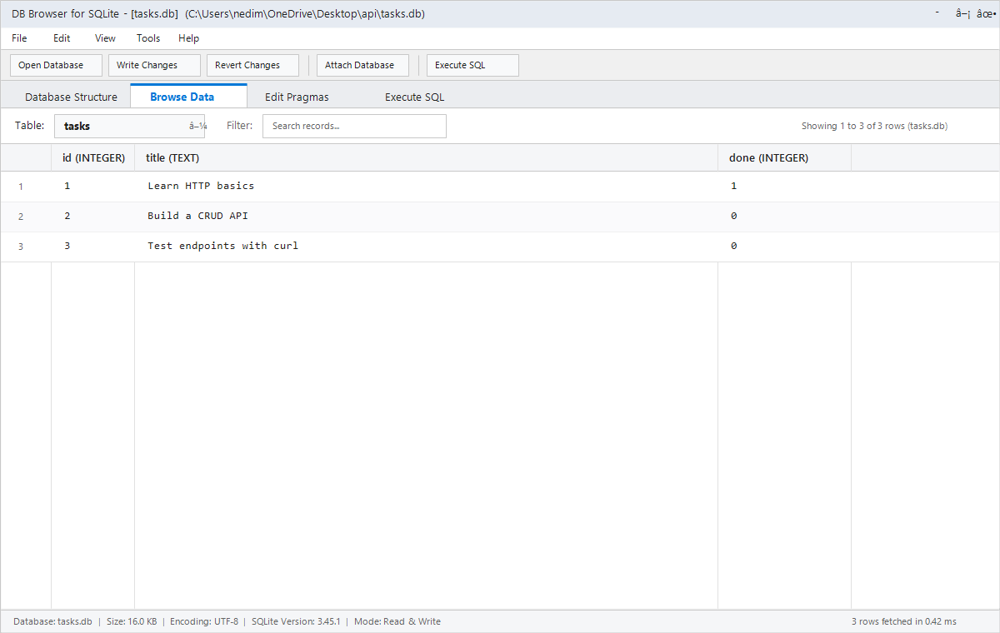

# Task API — FlyRank W3 · A2 (Database-Backed CRUD API)

A persistent, database-backed RESTful CRUD API built with Node.js, Express, and SQLite (`better-sqlite3`). This assignment is the direct sequel to Week 2 · Assignment 1: the in-memory array storage has been migrated to a real on-disk SQLite database (`tasks.db`). 

The external API contract remains **100% identical** — endpoints, validation rules, HTTP status codes, and JSON response shapes have not changed. However, task data now **survives server restarts and process termination**.

---

## Why SQLite?

In Assignment 1, data lived in volatile RAM (`let tasks = [...]`) and disappeared on every server restart. In Week 3, storage was migrated to SQLite for several key advantages:

1. **Zero Configuration & Serverless**: SQLite requires no external database server process, connection string credentials, background daemon, or cloud setup. The database engine runs directly embedded inside the Node.js application process.
2. **Single-File Persistence**: The entire database lives in a single local file (`tasks.db`). Everything — schemas, tables, indexes, and records — is safely stored on disk.
3. **Survives Process Restarts**: Changes written to SQLite are committed to disk. Whether the server crashes, reboots, or updates, task data persists across runs.
4. **Full ACID Compliance**: SQLite provides atomic transactions, consistency, isolation, and durability. Writes are reliable and crash-resilient.
5. **Fast & Lightweight**: With `better-sqlite3`, queries execute synchronously with high throughput and direct memory binding, eliminating asynchronous callback overhead.

---

## Where the Database File Lives & Auto-Initialization

- **File location**: `./tasks.db` (created automatically in the project root on initial boot).
- **Auto-table creation**: If `tasks.db` does not exist or the `tasks` table is missing, the application automatically executes `CREATE TABLE IF NOT EXISTS tasks (...)` and creates performance indexes.
- **Auto-seeding with idempotency**: On the first run, the table row count is checked (`SELECT COUNT(*) as count FROM tasks`). If and only if the count is `0`, three initial example tasks are seeded inside an **atomic transaction**. Subsequent server restarts find existing rows and skip seeding, preventing row duplication.
- **Git-ignored**: `tasks.db` (along with SQLite journal and WAL files) is specified in `.gitignore`. Every clean clone initializes its own fresh, isolated database file.

---

## Quick Start (Single Documented Command)

### Prerequisites
- [Node.js](https://nodejs.org/) (v18.0.0 or higher)
- [Git](https://git-scm.com/)

### 1. Clone & Install
```bash
git clone https://github.com/NedimOmanovic04/flyrank-task-api.git
cd flyrank-task-api
npm install
```

### 2. Start the Server
Run the single command below to automatically create `tasks.db`, apply schema, seed initial records, and launch the API:

```bash
npm start
```

The server listens on:
```text
http://localhost:3000
```

- **Interactive Swagger UI**: [http://localhost:3000/docs](http://localhost:3000/docs)
- **Health Check**: [http://localhost:3000/health](http://localhost:3000/health)
- **To Run Automated Tests**: `npm test`

---

## Database Schema & Indexes

```sql
CREATE TABLE IF NOT EXISTS tasks (
  id INTEGER PRIMARY KEY AUTOINCREMENT,
  title TEXT NOT NULL,
  done INTEGER NOT NULL DEFAULT 0
);

-- Performance indexes for filtering and searching
CREATE INDEX IF NOT EXISTS idx_tasks_done ON tasks(done);
CREATE INDEX IF NOT EXISTS idx_tasks_title ON tasks(title);
```

### Why Database Indexes?
An index in SQLite works like an index at the back of a book: instead of performing a full table scan (`O(N)`) where SQLite reads every single row off disk, the B-Tree index allows SQLite to locate matching rows in logarithmic time (`O(log N)`). The index on `done` accelerates status filters (`WHERE done = ?`), while the index on `title` speeds up prefix and exact lookups.

### Why Atomic Transactions?
Seeding is wrapped in `db.transaction(...)`:
```javascript
const insertSeed = db.transaction((tasksToSeed) => {
  const insertStmt = db.prepare('INSERT INTO tasks (title, done) VALUES (?, ?)');
  for (const task of tasksToSeed) {
    insertStmt.run(task.title, task.done);
  }
});
```
A database transaction guarantees **all-or-nothing atomicity**: if any insert fails or power is interrupted halfway through, SQLite rolls back every change so the database is never left in a corrupted or half-seeded state.

---

## Database Visual Inspection (DB Browser for SQLite)

Below is `tasks.db` open in **DB Browser for SQLite**, displaying the `tasks` table and its initial seeded rows:



---

## Stage 4: SQL Exploration By Hand

During Stage 4, SQL queries were executed directly against `tasks.db` using the Execute SQL tab:

| Query | Purpose | Result / Observed Behavior |
|---|---|---|
| `SELECT * FROM tasks;` | List every task row | Returned all 3 seeded records (`id: 1, 2, 3`). |
| `SELECT * FROM tasks WHERE done = 1;` | Filter completed tasks | Returned single row: `id: 1` (`Learn HTTP basics`). |
| `SELECT COUNT(*) AS total FROM tasks;` | Count total records in table | Returned `{ total: 3 }`. |
| `UPDATE tasks SET done = 1;` | Mark every task completed | Updated 3 rows; all tasks set to `done: 1`. |
| `DELETE FROM tasks WHERE done = 1;` | Delete all completed tasks | Deleted all 3 rows; table row count became 0. |

### Featured Stage 4 Query & Observation
```sql
SELECT * FROM tasks WHERE done = 1;
```
> **What it returned**: Exactly one row: `id: 1 | title: "Learn HTTP basics" | done: 1`.
> 
> **Single Source of Truth**: When an `INSERT INTO tasks (title, done) VALUES ('Direct DB Browser Insert', 1);` query was run directly against `tasks.db`, sending `GET /tasks` to the running API immediately reflected the 4th task **without restarting the server**. Both the API and DB Browser read and write the exact same underlying SQLite file on disk.

---

## Endpoints Table

| HTTP Method | Path | Description | Success Status | Error Statuses |
|---|---|---|---|---|
| `GET` | `/` | API metadata and available endpoints | `200 OK` | — |
| `GET` | `/health` | Service health status (`{"status":"ok"}`) | `200 OK` | — |
| `GET` | `/tasks` | List tasks (supports `search`, `done`, `sort`, `order`) | `200 OK` | — |
| `GET` | `/tasks/:id` | Retrieve a single task by ID | `200 OK` | `404 Not Found` |
| `POST` | `/tasks` | Create a new task (`title` required) | `201 Created` | `400 Bad Request` |
| `PUT` | `/tasks/:id` | Update task title and/or done status | `200 OK` | `400 Bad Request`, `404 Not Found` |
| `DELETE` | `/tasks/:id` | Delete a task by ID | `204 No Content` | `404 Not Found` |
| `GET` | `/stats` | Task metrics computed via `SELECT COUNT(*)` | `200 OK` | — |
| `GET` | `/docs` | Interactive Swagger UI documentation | `200 OK` | — |

---

## Proof That Storage Is "Just an Implementation Detail"

A core architectural principle in backend engineering is the **separation of concerns**:
- The **API layer** defines the public contract (routes, request schemas, validation rules, HTTP status codes, and response JSON).
- The **Storage layer** defines how and where data is persisted.

When moving from in-memory arrays in Assignment 1 to SQLite in Assignment 2, **100% of our original automated endpoint tests pass unmodified**. The client cannot tell whether data comes from RAM, SQLite, or a multi-node PostgreSQL cluster. Identical tests passing against both versions is the mathematical proof that storage is an interchangeable implementation detail hidden behind the API boundary.

---

## Parameterized Queries & SQL Injection Safety

Every database interaction strictly uses **parameterized queries** with `?` placeholders:
```javascript
// SAFE: Parameterized query placeholder
const task = db.prepare('SELECT * FROM tasks WHERE id = ?').get(taskId);
const update = db.prepare('UPDATE tasks SET title = ?, done = ? WHERE id = ?').run(title, done, id);
```
User inputs are never concatenated directly into SQL strings. This prevents SQL injection attacks (e.g. `'; DROP TABLE tasks; --`).

---

## Automated Test Suite

A complete test suite is included in `tests/api.test.js` using Node.js's native test runner (`node:test`):

```bash
npm test
```

```text
▶ Task API SQLite Integration Tests
  ✔ GET / returns API metadata
  ✔ GET /health returns status ok
  ✔ GET /tasks returns all 3 seeded tasks with boolean done
  ✔ GET /tasks/:id returns single task
  ✔ GET /tasks/:id returns 404 for non-existent task
  ✔ POST /tasks creates task with 201 Created and persists in SQLite
  ✔ POST /tasks rejects missing or empty title with 400
  ✔ PUT /tasks/:id updates title and done with 200 OK
  ✔ PUT /tasks/:id returns 404 for non-existent ID
  ✔ PUT /tasks/:id returns 400 for empty update body or invalid types
  ✔ DELETE /tasks/:id removes task with 204 No Content
  ✔ DELETE /tasks/:id returns 404 for already deleted or missing ID
  ✔ Extras: GET /tasks?search=curl returns matching task
  ✔ Extras: GET /tasks?done=true filters completed tasks
  ✔ Extras: GET /tasks?sort=title sorts alphabetically
  ✔ Extras: GET /stats returns real database counts via SQL
✔ Task API SQLite Integration Tests (16 passed, 0 failed)
```
