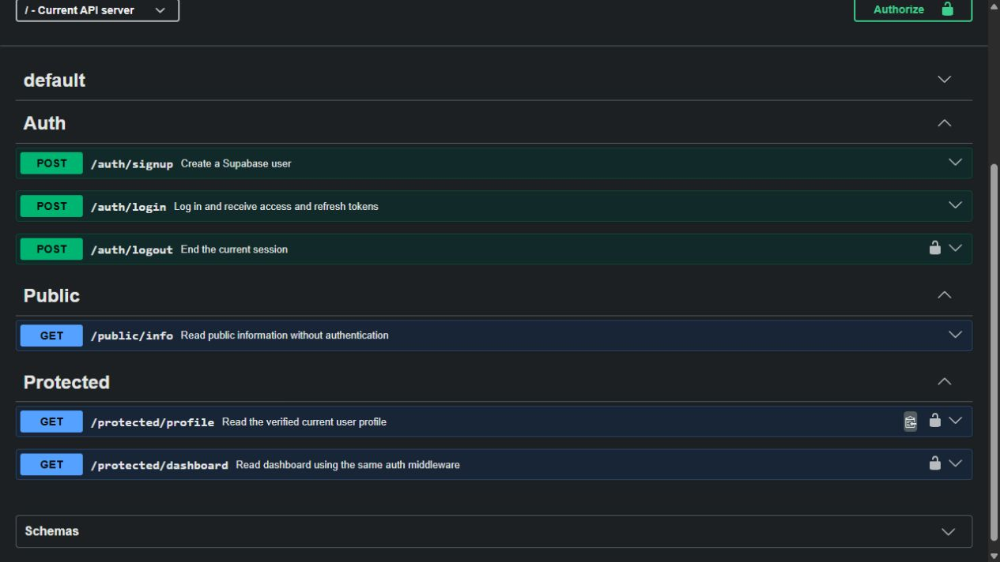

# Task API — A4: Auth, Login & Protect

Express API using Supabase Auth for signup, password login, token verification and logout. A reusable middleware protects the profile, dashboard and logout routes. Swagger UI supports Bearer authorization. The PostgreSQL task API from A3 is retained.

## Quick start

Requires Docker Desktop with Linux containers and Compose v2. For tests or local Node development, use Node.js 24+.

1. Clone this repository and enter its directory.
2. Copy `.env.example` to `.env` (`Copy-Item .env.example .env` in PowerShell, `cp .env.example .env` in Bash). When upgrading an existing checkout, keep your `.env` and add the Supabase variables.
3. Configure the Postgres password in both `POSTGRES_PASSWORD` and `DATABASE_URL`. Their usernames and database names must also match. Keep the hostname `db` when running in Docker. Use a URL-safe password or percent-encode it in `DATABASE_URL`.
4. Create a free project in the [Supabase Dashboard](https://supabase.com/dashboard). Open **Connect** for the Project URL and publishable key, or **Settings → API Keys** for the key. A legacy `anon` key also works. Never use a `service_role` or secret key for this application.
5. Add these values to `.env`:

```dotenv
SUPABASE_URL=https://your-project-ref.supabase.co
SUPABASE_KEY=your_anon_or_publishable_key
PORT=3000
```

Use the API URL above, not the `supabase.com/dashboard/project/...` dashboard URL. Supabase's database password is separate from this app's local Postgres password; this app only uses Supabase for authentication.

Start the whole stack with one command:

```sh
docker compose up --build
```

Open [Swagger UI](http://localhost:3000/docs), [public info](http://localhost:3000/public/info), or [health](http://localhost:3000/health). Compose publishes port 3000; `PORT` applies when running Node directly. Startup configures the Supabase client and initializes the task database. A successful startup does not by itself prove Supabase credentials work; signup/login provide that check.

**Email confirmation stays enabled.** Register with an address you control and click the confirmation link before logging in. In Supabase **Authentication → URL Configuration**, set the Site URL to `http://localhost:3000` for this practice project so the confirmation redirects back to the local API.

`.env` is ignored by Git and excluded from Docker builds. Only placeholders belong in `.env.example`. Passwords and tokens are never stored in the task database. Existing Postgres volumes keep their original credentials when `.env` is edited.

## API reference

| Method | Path | Bearer token | Success | Expected errors |
| --- | --- | --- | --- | --- |
| POST | `/auth/signup` | No | 201, `{ "user": ... }` | 400 for missing/invalid credentials |
| POST | `/auth/login` | No | 200, access and refresh tokens | 400 for missing fields; 401 for failed login |
| POST | `/auth/logout` | Yes | 204, empty body | 401 for missing/invalid token |
| GET | `/protected/profile` | Yes | 200, `id`, `email`, `created_at` | 401 for missing/invalid token |
| GET | `/protected/dashboard` | Yes | 200, greeting and verified `user_id` | 401 for missing/invalid token |
| GET | `/public/info` | No | 200, public greeting | — |
| GET | `/tasks`, `/tasks/:id`, `/stats` | No | 200, task data/statistics | 404 for unknown task |
| POST | `/tasks` | No | 201, task | 400 for invalid title |
| PUT | `/tasks/:id` | No | 200, task | 400 for invalid input; 404 for unknown task |
| DELETE | `/tasks/:id` | No | 204 | 404 for unknown task |
| GET | `/health`, `/`, `/docs` | No | 200 | — |

Auth routes return JSON errors under `error`. Missing, blank or non-string email/password fields return 400. Failed login returns `{ "error": "Invalid login credentials" }`. Missing/malformed headers return `{ "error": "Access token required" }`; invalid or expired tokens return `{ "error": "Invalid or expired token" }`. Supabase service failures and upstream rate limits return 503 with a generic error. Malformed JSON returns 400.

Task routes retain their A3 public behavior; A4 authentication is demonstrated on `/protected/*` and `/auth/logout`. Task data is shared and has no per-user ownership rules. A3 schema, filters, persistence and local Postgres setup are documented in [the archived A3 README](docs/A3-README.md).

## Try the authentication flow

In PowerShell, use `curl.exe` for curl commands. The following commands use a temporary JSON file to avoid Windows quoting issues. Replace the sample email and password with your test credentials:

```powershell
'{"email":"your-email@example.com","password":"choose-a-strong-password"}' | Set-Content -Encoding ascii credentials.json
curl.exe -i -X POST http://localhost:3000/auth/signup -H "Content-Type: application/json" --data-binary '@credentials.json'
# Click the Supabase email confirmation link before continuing.
$session = Invoke-RestMethod -Method Post -Uri http://localhost:3000/auth/login -ContentType 'application/json' -InFile credentials.json
$token = $session.access_token
curl.exe -i http://localhost:3000/public/info
curl.exe -i http://localhost:3000/protected/profile
curl.exe -i http://localhost:3000/protected/profile -H "Authorization: Bearer $token"
curl.exe -i http://localhost:3000/protected/dashboard -H "Authorization: Bearer $token"
curl.exe -i http://localhost:3000/protected/profile -H "Authorization: Bearer invalid-token"
curl.exe -i -X POST http://localhost:3000/auth/logout -H "Authorization: Bearer $token"
Remove-Item -LiteralPath credentials.json
```

Expect 201 on signup, 200 on login/public/valid protected calls, 401 without a token or with a bad token, and 204 with an empty body on logout. `credentials.json` is git-ignored. Never capture session tokens in screenshots.

The guard parses `Authorization: Bearer <token>` and calls `supabase.auth.getUser(token)` on every protected request. It trusts the verified Supabase user rather than decoding an unverified JWT payload. Every request uses a fresh SDK client with session persistence and refresh timers disabled, so one user's login cannot change another user's session.

Logout calls `auth.admin.signOut(token, 'local')`, the SDK's token-based server logout method. It sends the caller's access token to Supabase's logout endpoint using the project's public key; no service-role key is needed. It revokes refresh tokens for that session. Already-issued access JWTs may remain valid until expiry; clients should discard both tokens after logout. See [Supabase sign-out behavior](https://supabase.com/docs/guides/auth/signout).

## Swagger UI

1. Open `/docs` and use **Try it out** on `/auth/signup`. Confirm the email, then execute `/auth/login`.
2. Copy the login response's `access_token`.
3. Click **Authorize**, paste only that token (without the `Bearer ` prefix), then click **Authorize** and **Close**.
4. Execute `/protected/profile` and `/protected/dashboard`; both should return 200.
5. Execute `/auth/logout`; expect 204. Clear Swagger authorization afterwards.

Swagger supplies the header automatically. Only protected operations show authorization locks. The screenshot below is from the actual A4 Swagger page and shows route/security configuration; it does not prove a successful real-user login.



## Tests and verification

```sh
npm ci
npm test
```

The 16 auth tests use the real Supabase SDK with an isolated fake HTTP transport. They cover validation, signup, login, bearer parsing, invalid tokens, protected routes, concurrent-user isolation, token-specific logout, empty 204 responses and Swagger security declarations. They require neither a Supabase account nor a database.

The existing 19 PostgreSQL integration tests run separately:

```sh
npm run test:db
```

To repeat the real-service check, set `AUTH_TEST_EMAIL` and `AUTH_TEST_PASSWORD` in your ignored `.env`. For a new account run `npm run test:live -- --signup`, click the confirmation email, then run `npm run test:live`. The script checks real status codes, valid/tampered tokens and logout without printing credentials or tokens.

Set `TEST_DATABASE_URL` to a separate disposable PostgreSQL database first; these tests reset the task table. See the A3 README for local database networking. The A4 image build, 16 auth tests and all 19 PostgreSQL regression tests have passed. The confirmed-email signup/login flow, valid and tampered tokens, and logout also passed against real Supabase, including curl and Swagger UI checks. See [A4 verification notes](docs/A4-verification.md).

For local Node development, use `npm start` after `npm ci`. Configure `DATABASE_URL` for a reachable Postgres instance (use `localhost` with a loopback-published database port); Docker's `db` hostname is only available inside its network. Node loads `.env` automatically through the start script.

## References

- [Supabase JavaScript signup](https://supabase.com/docs/reference/javascript/auth-signup)
- [Supabase password login](https://supabase.com/docs/reference/javascript/auth-signinwithpassword)
- [Supabase verified user retrieval](https://supabase.com/docs/reference/javascript/auth-getuser)
- [Supabase API keys](https://supabase.com/docs/guides/getting-started/api-keys)
- [Swagger Bearer authentication](https://swagger.io/docs/specification/v3_0/authentication/bearer-authentication/)

The optional A4 AI rematch is excluded.
